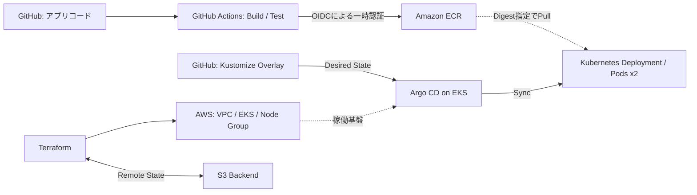

# Terraform × Amazon EKS × GitOps Platform

TerraformでAWS基盤を構築し、Amazon EKS上のアプリケーションをGitHub ActionsとArgo CDで管理する、**Production-likeな個人開発プロジェクト**です。

IaCによるインフラ構築から、コンテナのビルド・検証、GitOpsによるデプロイ、ロールバック、基本的な障害復旧までを実装・検証しました。

> **公開用ポートフォリオについて**
>
> 本リポジトリは、Private環境で実装・検証したTerraform × Amazon EKS × GitOps構成の公開用スナップショットです。
>
> AWSアカウントID、ECR URI、GitHub識別情報の一部は、セキュリティとプライバシーに配慮してプレースホルダーに置き換えています。
>
> 実際の環境へデプロイする場合は、AWSリソース、ECRイメージ、Terraform Backend、認証設定などを利用環境に合わせて設定する必要があります。
>
> **注意：** 公開用のKustomizeに記載されているECR URIとDigestはダミー値のため、そのままではコンテナを起動できません。

> **検証環境の現在の状態：** コスト削減のため、EKS・Worker Node・VPC・NAT GatewayはDestroy済みです。実際の検証環境で使用したECR・GitHub OIDC・S3 BackendはPrivate環境で保持しています。本リポジトリは常時稼働する公開サービスではありません。

## アーキテクチャ概要


### 詳細ドキュメント

- 📐 [AWS・GitOps構成図と設計方針](docs/architecture.md)
- ✅ [検証結果・エビデンス](docs/portfolio-evidence.md)

※ 新しいイメージDigestのKustomizeへの反映は**手動コミット**です。CIからEKSへ直接デプロイする仕組みではありません。

## 技術スタック

| 分野 | 使用技術 |
| --- | --- |
| IaC / Cloud | Terraform、AWS（VPC、EKS、S3） |
| Container / Registry | Docker、Amazon ECR |
| Kubernetes | Amazon EKS、Managed Node Group、Kustomize |
| CI / GitOps | GitHub Actions、Argo CD |
| 認証 | AWS IAM Identity Center、GitHub OIDC、読み取り専用SSH Deploy Key |
| アプリ / 開発支援 | Python、OpenAI Codex |

## 主な実装と検証結果

- **インフラ構築：** Terraformで2AZのVPC、Private Subnet上のEKS Worker Node 2台などを構築。Destroyと再構築を検証。
- **State分離：** EKS・ネットワークと、永続保持するECR・GitHub OIDC・S3 Backendの管理範囲を分離。
- **CI：** GitHub ActionsでDocker Build、`/health`のSmoke Test、OIDC認証によるECR Pushを実装。
- **Kubernetes：** Deployment 2 replicas、ヘルスチェック、リソース制限、非root実行を確認。
- **GitOps：** Argo CDによるKustomizeの同期（`Synced / Healthy`）、Image Digest更新によるAuto Syncを検証。
- **ロールバック・復旧：** Git Revertによる旧イメージへの復帰、Pod自己復旧、Argo CD Self-Healを確認。
- **AI活用：** Codexを利用してKustomize検証用CIを開発。要件定義・レビュー・採用判断は人間が実施。

## 設計上の工夫とトレードオフ

| 判断 | 意図・制約 |
| --- | --- |
| Worker NodeをPrivate Subnetに配置 | ノードの直接公開を避ける |
| NAT Gatewayを1基に限定 | 開発コストを抑える一方、単一障害点となる |
| GitHub OIDCを使用 | CIで長期AWSアクセスキーを保持しない |
| イメージをDigestで固定 | デプロイ対象とロールバック先を明確化 |
| CIとCDを分離 | GitHub Actionsはイメージ生成、Argo CDはGitの状態をEKSへ反映 |
| EKS環境を作業終了時にDestroy | 時間課金を抑える。Argo CDや接続Secretは再構築が必要 |

## リポジトリ構成

```text
bootstrap/                 # Terraform S3 Backend
modules/                   # network / eks / ecr / github-oidc
environments/dev/          # EKS・ネットワーク用のTerraform Root
  registry/                # 永続ECR用の独立State
  ci/                      # 永続GitHub OIDC用の独立State
app/                       # PythonアプリとDockerfile
k8s/base/                  # Deployment / Service
k8s/overlays/dev/          # dev環境のKustomize設定
gitops/                    # Argo CD Helm values / Application定義
.github/workflows/         # CI・検証用Workflow
docs/                      # Runbook、検証証跡、AI活用記録
```

## 動作証跡

| 証跡 | 内容 |
| --- | --- |
| [GitHub Actions](docs/evidence/github-actions-success.png) | CIの実行成功 |
| [Argo CD](docs/evidence/argocd-synced-healthy.png) | `Synced / Healthy` |
| [Kubernetes](docs/evidence/kubernetes-pods.png) | Deployment・Podの正常稼働 |
| [Terraform State](docs/evidence/terraform-state.png) | Terraformの管理対象リソース一覧（Apply成功ログではありません） |

ロールバックやSelf-Healは実機で動作を確認しました。スクリーンショット以外の検証内容は上記の実装記録に基づきます。

## 運用・再構築

Windows 11 / PowerShellを使用。AWSへの接続はIAM Identity CenterのSSOプロファイルを利用し、Terraformの環境固有値やSSH秘密鍵はGitで管理しません。

EKSの再構築、Argo CDの導入・接続復元、同期確認、Destroyの手順は[Argo CD Bootstrap / Recovery Runbook](docs/argocd-runbook.md)を参照してください。

## AIを活用した開発

[AI-Assisted Development](docs/ai-assisted-development.md)に、Codexで作成したKustomize検証Workflowの要件・実装範囲・レビュー過程を記録しています。

## 現時点の制約と今後の予定

このプロジェクトは**本番相当の構成を題材にした検証環境**であり、商用本番環境と同等の高可用性・監視・運用品質を保証するものではありません。

今後はPod IdentityとSecrets Managerの連携、監視・ログ・アラート、IAM権限の整理、再構築の完全検証を追加予定です。CIでPushした新しいImage DigestをGitへ自動反映する仕組みも未実装です。
