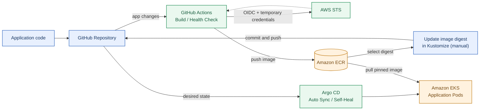
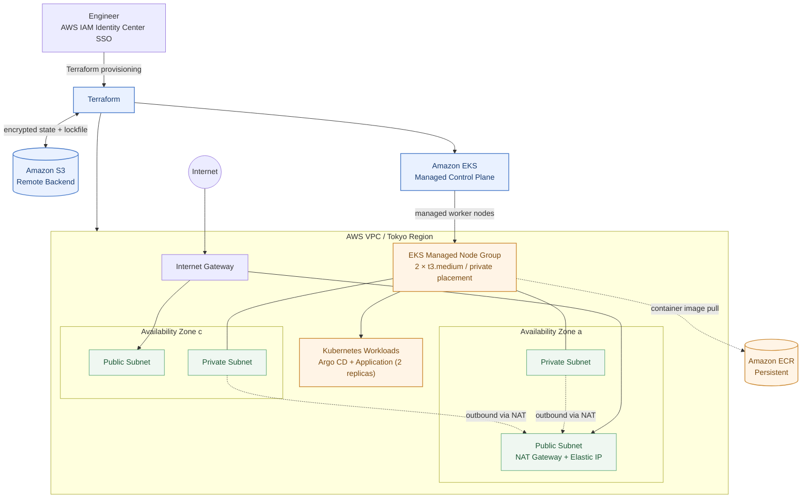
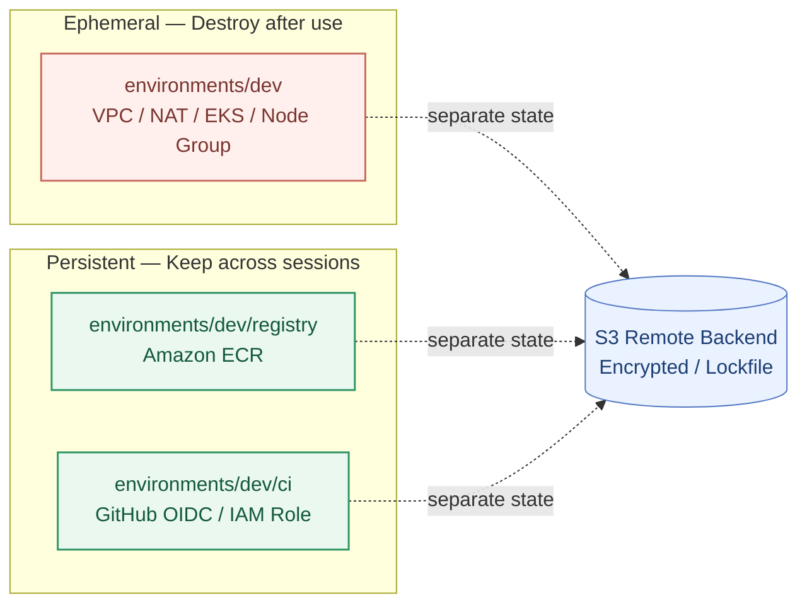

# Architecture & Design Decisions

> **Terraform × Amazon EKS × GitOps Platform**  
> AWS基盤の構築からコンテナCI、GitOpsデプロイ、復旧検証までを一貫して実装した、学習・ポートフォリオ向けの **Production-like Kubernetes Platform** です。

| Infrastructure | Delivery | Reliability | Operations |
| :---: | :---: | :---: | :---: |
| **Terraform / Amazon EKS** | **GitHub Actions / Argo CD** | **Digest固定 / Self-Heal** | **SSO / 分離State / Destroy** |

> **現在の状態：** EKS・VPC・NAT Gatewayなどの一時リソースはコスト抑制のためDestroy済みです。以下は構築・検証時の構成を示します。ECR、GitHub OIDC、Terraform Backendは別Stateで保持しています。

---

## 01 — Platform at a glance

**コードの変更から実行環境への反映まで**を、CIとGitOpsに分離した構成です。

**ポイント：** GitHub ActionsはイメージのビルドとECRへのPushを担当します。**ECRにPushしただけではEKSへ自動デプロイされません。** 現段階ではKustomizeのImage Digestを**手動更新してCommit**し、その変更をArgo CDが自動反映します。

## 02 — AWS infrastructure

**ネットワーク・クラスター設計**

| 項目 | 実装内容 / 意図 |
|---|---|
| Multi-AZ | 2つのAZそれぞれにPublic / Private Subnetを配置 |
| Worker Node | Managed Node Group、`t3.medium` × 2（希望台数）。Private Subnetへ配置 |
| NAT Gateway | 1基に集約して開発費用を抑制。**AZ障害時の可用性は制約あり** |
| EKS API | Public / Private Endpointを有効化。Public側は許可CIDRで制限 |
| EKS管理者認証 | IAM Identity CenterからAWS認証し、EKS Access Entryで認可 |
| アプリ公開範囲 | Kubernetes ServiceとArgo CD Serverは`ClusterIP`。インターネット向けLoad Balancerは設けない |

*図は論理構成です。Worker NodeのAZ間配置やPodの配置先は、Kubernetes / EKSのスケジューリング状態によって変わります。*

## 03 — State boundaries & lifecycle

**高コストな開発基盤だけを停止し、再利用する基盤は残す**ため、TerraformのRoot ModuleとStateを分離しています。

- `environments/dev/`：作業時にApplyし、終了時にDestroy。**このRootのみDestroy対象**。
- `environments/dev/registry/`：ECRのイメージを保持。
- `environments/dev/ci/`：GitHub OIDC / IAM Roleを保持。
- `bootstrap/`：Remote Backendを初期構築。通常のDestroy対象には含めない。

StateはS3に暗号化して保存し、`use_lockfile`で同時操作を制御します。**Stateファイルや認証情報はGit管理しません。**

## 04 — Security & delivery controls

| レイヤー | 実装している対策 |
|---|---|
| CI → AWS | 長期アクセスキーを使わず、GitHub OIDCとSTSによる短期認証 |
| GitOps → GitHub | 読み取り専用SSH Deploy Key（秘密鍵はGitに保存しない） |
| Image integrity | KustomizeでECRイメージを`sha256` Digestに固定 |
| Pod hardening | 非root実行、権限昇格禁止、Read-only Root FS、Linux Capabilities削除、seccomp適用 |
| Workload health | Readiness / Liveness Probe、CPU・メモリのRequests / Limitsを設定 |
| GitOps reconciliation | Argo CD `automated.enabled: true` / `selfHeal: true`。`prune: false`なので自動削除は無効 |
| CI validation | Kustomize生成結果とECR Digest形式をGitHub Actionsで検証（AWSへの接続不要） |

**検証済みの動作：** CIによるDocker Build / Health Check / ECR Push、Argo CDの`Synced / Healthy`、Git Revertによる旧Digestへのロールバック、Podの自己復旧、Argo CDによるSelf-Heal。詳細は[Validation Evidence](portfolio-evidence.md)を参照してください。

## 05 — Design trade-offs & next steps

| 判断 | 得られるメリット | 現状の制約 |
|---|---|---|
| NAT Gatewayを1基にする | ランニングコストを抑制 | NATの単一障害点が残る |
| ECR・OIDCを別Stateにする | EKSを削除してもイメージとCI認証基盤を保持 | Rootごとの操作と管理が必要 |
| Image Digestを固定する | 意図したイメージを再現可能 | Digest更新は現状手動 |
| Argo CDでSelf-Heal | Gitの宣言状態へ自動復旧 | `prune: false`で不要リソースの自動削除なし |
| `ClusterIP`を使用する | アプリ管理面の外部公開を避ける | 公開Webサービス用のIngress / LBは未実装 |

**今後の拡張候補：** EKS Pod IdentityとSecrets Manager連携、監視・アラート、CIからDigest更新までの自動化、可用性・IAM権限の追加強化。

---

### Related documents

- [Project README](../README.md)
- [Validation Evidence & Screenshots](portfolio-evidence.md)
- [Argo CD Bootstrap / Recovery Runbook](argocd-runbook.md)
- [AI-Assisted Development](ai-assisted-development.md)

> **Scope note:** 本資料は構築・検証した構成と設計意図を示すものです。商用本番環境相当の高可用性・可観測性・運用SLAを達成したという主張ではありません。
