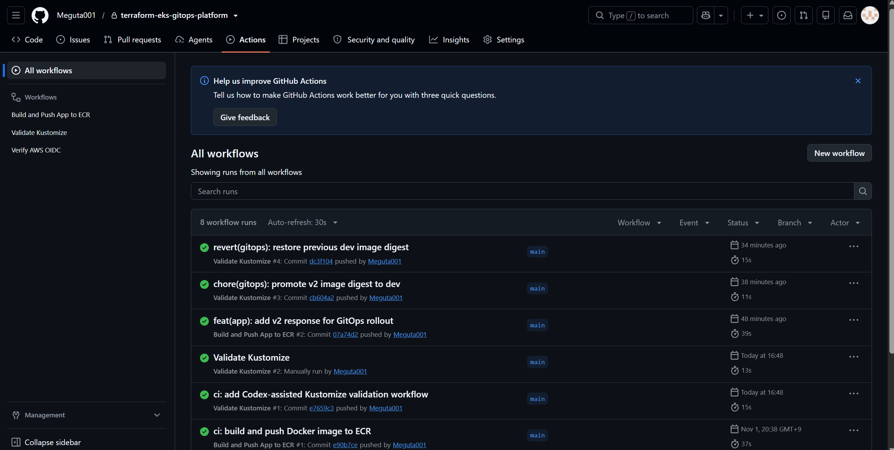
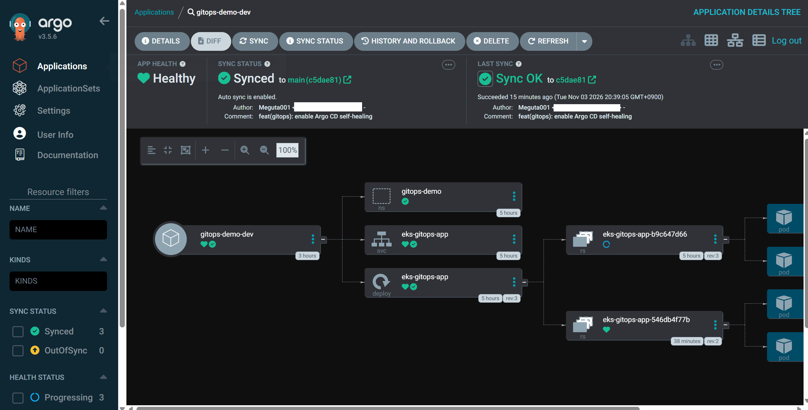
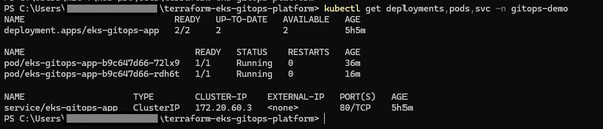
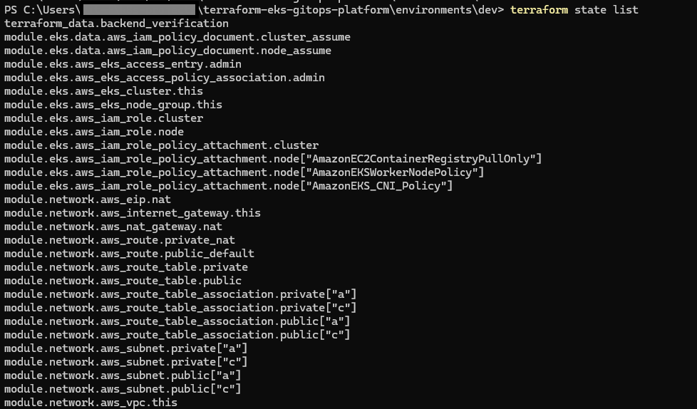

# Validation Evidence — Terraform × Amazon EKS × GitOps Platform

このドキュメントは、個人開発で実施した**構築・デプロイ・動作検証の結果**をまとめたものです。実際に確認した内容と、スクリーンショットだけでは証明できない内容を区別して記載しています。

> **環境の状態:** 検証完了後、コスト削減のため開発用EKS・VPC・NAT Gateway等はTerraformでDestroy済みです。掲載画像は**稼働中に取得した過去の検証記録**であり、現在の稼働状態を示すものではありません。ECR、GitHub OIDC、Terraform Backendは別Stateで保持する設計です。

## 1. 検証結果サマリー

| 領域 | 実施・確認した内容 | 結果 |
|---|---|---|
| Infrastructure as Code | TerraformによるVPC、Subnet、NAT Gateway、EKS、Managed Node Groupの構築 | 成功 |
| Kubernetes | Worker Node 2台の`Ready`、アプリケーションPodの正常稼働 | 成功 |
| Container CI/CD | GitHub ActionsでDocker Build、ヘルスチェック、Amazon ECRへのPush | 成功 |
| Manifest CI | GitHub ActionsでKustomizeマニフェストの生成・構造検証を実装、実行 | 確認済み |
| GitOps | Argo CDでアプリケーションの`Synced / Healthy`を確認 | 成功 |
| GitOps更新 | アプリの更新とECRイメージDigestの変更をGit経由で反映 | 成功 |
| Rollback | Git Revertによって以前のイメージDigestへ復帰 | 成功 |
| Self-healing | Podの自己復旧、およびArgo CDのSelf-Healを検証 | 成功 |
| Cost Control | `environments/dev`のDestroy後、EKS・NAT Gateway・EIP等の削除を確認 | 成功 |

※「成功」は開発時の実行・確認結果です。全操作のログや独立した自動テスト証跡を網羅していることを意味しません。

## 2. スクリーンショット

### GitHub Actions — CI実行結果

GitHub Actionsの実行結果を確認した際の画面です。DockerイメージのBuild・ヘルスチェック・ECR Pushの検証結果と、マニフェスト検証用Workflowの実装内容はリポジトリの`.github/workflows/`で確認できます。

### Argo CD — GitOps同期状態

Argo CD Applicationが`Synced / Healthy`となった状態を記録しています。Gitを宣言的な構成の正本とし、Kustomizeのdev Overlayを同期対象にしました。

### Kubernetes — ワークロード稼働

Worker Node・Podなどの稼働状況を`kubectl`で確認した記録です。DeploymentではアプリPodを2レプリカとし、Readiness / Liveness Probe、CPU・メモリのRequests / Limitsなどを定義しています。

### Terraform — 管理対象リソース

`terraform state list`により、Terraformで管理するAWSリソースを確認した記録です。**この画像はStateの管理対象を示すものであり、差分ゼロや全リソースの正常稼働を単独で証明するものではありません。**

## 3. 実装・検証上のポイント

- **認証:** GitHub ActionsからAWSへのアクセスにOIDCによる一時認証情報を使用。長期有効なAWSアクセスキーをWorkflowに保存しない設計。
- **再現性:** コンテナイメージをECRのDigestで固定し、Gitで変更・復帰できる構成。
- **GitOps:** Argo CDの自動同期とSelf-Healを検証。イメージDigestのGit反映は現段階では手動。
- **分離:** EKS・Networkを一時環境とし、ECR・GitHub OIDC・Terraform Backendは別Stateで永続保持。
- **費用管理:** 非作業時は開発用インフラをDestroy。再構築手順をRunbookとして管理。

## 4. 関連ドキュメント・実装

| 内容 | 参照先 |
|---|---|
| プロジェクト全体 | [README](../README.md) |
| Argo CD導入・再構築手順 | [Argo CD Runbook](argocd-runbook.md) |
| AIを活用したManifest CIの開発記録 | [AI-Assisted Development](ai-assisted-development.md) |
| GitHub Actionsの定義 | [Workflows](../.github/workflows/) |
| GitOps Application定義 | [Application](../gitops/apps/dev-application.yaml) |
| Kubernetesマニフェスト | [Kustomize dev Overlay](../k8s/overlays/dev/) |
| Terraformの開発環境 | [Terraform Root](../environments/dev/) |

## 5. 検証範囲と今後の改善

本プロジェクトは**Production-like構成を学習・検証するための環境**です。商用本番環境と同等の耐障害性・監視体制を備えているという主張ではありません。

今後の対象は、Pod Identity / Secrets Manager連携、監視・アラート、セキュリティ強化などです。なお、GitHub公開前には**ソースコード・Git履歴・Actionsログ・画像の機密情報監査**を別途完了させます。
